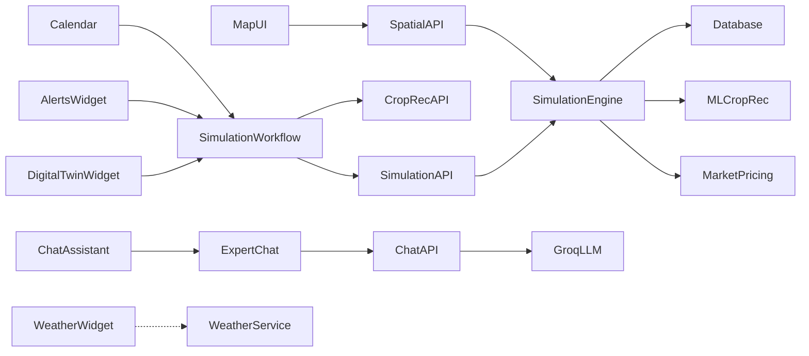

# Module Documentation - AgriBrain

## Module Index

| Module | Type | Status | Verification |
|--------|------|--------|--------------|
| MapUI | Frontend Component | ✅ Complete | Build ✓ |
| FarmContext | Frontend State | ✅ Complete | Build ✓ |
| Simulation Workflow | Frontend Page | ✅ Complete | Build ✓ |
| Calendar | Frontend Page | ✅ Complete | Build ✓ |
| Expert Chat | Frontend Page | ✅ Complete | Build ✓ |
| WeatherWidget | Frontend Component | ⚠️ Mock Only | Visual ✓ |
| AlertsWidget | Frontend Component | ✅ Complete | Visual ✓ |
| DigitalTwinWidget | Frontend Component | ✅ Complete | Visual ✓ |
| ChatAssistant | Frontend Component | ✅ Complete | Visual ✓ |
| Spatial API | Backend API | ✅ Complete | Code ✓ |
| Simulation API | Backend API | ✅ Complete | Code ✓ |
| Chat API | Backend API | ✅ Complete | Code ✓ |
| Crop Recommendation API | Backend API | ✅ Complete | Tests ✓ |
---

## 1. MapUI Module

### Business Purpose
Interactive India district map allowing farmers to select their farm location via click or drag, with automatic soil/climate profile lookup.

### Actual Implementation
**File**: `frontend_web/src/components/MapUI.tsx` (500+ lines)
**Key Features**:
- Leaflet map with CartoDB Voyager tiles
- District boundaries from `/api/districts/geojson` (GeoJSON)
- Click handler → calls `/api/simulation/location` for reverse geocoding
- Visual pin with pulse animation (CSS keyframes)
- Drag-to-adjust pin position
- Fly-to animation when district selected from list
- Responsive: full-screen on mobile, sidebar on desktop

### Props Interface
```typescript
interface MapUIProps {
  onLocationSelect: (district: District, coords: [number, number], soilParams: SoilParams) => void;
  selectedDistrict: District | null;
  pinnedLocation: [number, number] | null;
  setPinnedLocation: (loc: [number, number] | null) => void;
  center?: [number, number];
  zoom?: number;
}
```

### Data Flow
1. User clicks map → `handleMapClick(e)` 
2. Gets lat/lng from event → calls `lookupLocation(lat, lng)`
3. `lookupLocation` → POST `/api/simulation/location` → backend `spatial.reverse_geocode`
4. Backend returns: district, state, soil_type, agro_zone, coordinates
5. `onLocationSelect(district, coords, soilParams)` → updates FarmContext
6. Visual pin rendered at `pinnedLocation`

### Key Functions
- `handleMapClick(e: LeafletMouseEvent)` - Click handler
- `handlePinDragEnd(e: DragEndEvent)` - Drag adjustment
- `lookupLocation(lat, lng)` - API call with loading state
- `flyToLocation(lat, lng, zoom)` - Programmatic map navigation
- `getSoilColor(soilType)` - Color coding for soil types

### Dependencies
- `react-leaflet`: MapContainer, TileLayer, GeoJSON, Marker, useMap
- `leaflet`: CSS, icon fixes
- `lucide-react`: Icons (MapPin, Loader2, etc.)
- `@/services/api`: lookupLocation function

### Status: ✅ COMPLETE & VERIFIED
- Builds successfully
- JSX props bug fixed (c0cfba0)
- Mobile responsive verified in code
| SimulationEngine | Backend Service | ✅ Complete | Code ✓ |
| ML Inference (XGBoost) | ML Service | ✅ Complete | Tests ✓ |
| Database Models | Backend Data | ✅ Defined | Schema ✓ |
---

## 2. FarmContext Module

### Business Purpose
Global React state management providing seamless data flow across all pages (simulate → calendar → expert-chat).

### Actual Implementation
**File**: `frontend_web/src/context/FarmContext.tsx` (200+ lines)
**Provider**: `FarmProvider` wraps entire app in `layout.tsx`

### State Structure
```typescript
interface FarmContextType {
  // Location
  coordinates: [number, number] | null;
  soilParams: SoilParams | null;
  selectedDistrict: District | null;
  
  // Farm Configuration
  farmParams: FarmParams | null;
  
---

## 3. Simulation Workflow Module (3-Step Wizard)

### Business Purpose
Guided flow: Select Location → Choose Crop → Run Simulation → View Results

### Actual Implementation
**File**: `frontend_web/src/app/simulate/page.tsx` (600+ lines)

### Step 1: Select Location
- **Component**: MapUI (full width on mobile, left panel on desktop)
- **Input**: User clicks map or enters coordinates
- **Output**: `selectedDistrict`, `coordinates`, `soilParams` → FarmContext
- **Validation**: Must have district before proceeding

### Step 2: Choose Crop
- **Component**: CropCard grid (from `/api/recommend`)
- **Input**: User clicks crop card
- **API Call**: `getCropRecommendations(lat, lng, soilParams)` → POST `/api/recommend`
- **Backend**: `crop_recommendation.recommend()` → XGBoost inference
- **Output**: `selectedCrop` → FarmContext

### Step 3: Run Simulation
- **Component**: InputPanel (farm params) + SimulationPanel (run button)
- **Input Form**: 
  - Land area (hectares)
  - Budget (INR)
  - Soil type (dropdown, pre-filled from step 1)
  - Planting season (Kharif/Rabi/Zaid)
  - Planting date
- **API Call**: `runSimulation(params)` → POST `/api/simulate` → backend `simulation.run`
- **Backend**: `SimulationEngine.run_simulation()` → Full digital twin
- **Output**: `simulationResults`, `calendarStages` → FarmContext
- **Navigation**: Auto-advance to `/calendar`

### Data Transformation (Frontend ↔ Backend)
```typescript
// Frontend → Backend mapping in /api/simulate/route.ts
{
  district_id: body.district_id || 1,
  selected_crop: body.crop_name,
  land_area_ha: body.land_area_ha,
  budget_inr: body.budget_inr || 100000,
  confirmed_soil_type: body.soil_type || "Alluvial Soil",
  rainfall_override_mm: body.rainfall_mm || 750,
  planting_season: body.planting_season || "Kharif",
  planned_start_date: body.planting_date || "2024-06-15"
}

// Backend → Frontend transformation
simulation = {
  crop_name: data.selected_crop,
  expected_yield_tons: data.estimated_yield_tons,
  expected_revenue_inr: data.market_value_inr,
  expected_profit_inr: data.net_profit_inr,
  roi_percent: data.roi_percentage,
  risk_level: data.risk_level,
  monthly_breakdown: [...] // 6 months generated
}
---

## 4. Calendar Module

### Business Purpose
Visual cultivation calendar with monthly stages, tasks, weather, alerts, and digital twin metrics.

### Actual Implementation
**File**: `frontend_web/src/app/calendar/page.tsx` (360+ lines)

### Key Features
1. **Stage Generation**: Maps `simulationResults.monthly_breakdown` (6 months) to growth stages (Germination → Harvest)
2. **Task Templates**: Stage-specific agronomic tasks (hardcoded per stage)
3. **Date Calculation**: Based on `farmParams.planned_start_date`
4. **Sidebar Widgets**: WeatherWidget, AlertsWidget, DigitalTwinWidget
5. **Progress Navigation**: Link to `/expert-chat` (step 5)

### Stage Mapping Logic
```typescript
const growthStages = ["Germination", "Vegetative", "Flowering", "Grain Filling", "Maturity", "Harvest"];
const stageName = growthStages[index] || `Month ${month.month}`;

const stageTasks: Record<string, string[]> = {
  "Germination": ["Monitor soil moisture daily", "Ensure proper seed depth", ...],
  "Vegetative": ["Apply nitrogen fertilizer", "Weed control", ...],
  // ... etc for all 6 stages
};
```

### Data Sources
- **Primary**: `simulationResults.monthly_breakdown` (from backend simulation)
- **Fallback**: Generated from `farmParams.planned_start_date`
- **Widgets**: Read from FarmContext (simulationResults, selectedCrop, farmParams)

### Status: ✅ COMPLETE & VERIFIED
- Build passes
- All widgets integrated
- Responsive layout (2/3 calendar, 1/3 widgets)
```

---

## 5. Expert Chat Module

### Business Purpose
Context-aware AI agronomist chat with full farm context and image analysis capability.

### Actual Implementation
**Files**: 
- `frontend_web/src/app/expert-chat/page.tsx` (250+ lines)
- `frontend_web/src/components/ChatAssistant.tsx` (300+ lines)

### Context Injection
```typescript
const context = {
  selected_crop: selectedCrop,
  farm_params: farmParams,
  simulation_results: simulationResults,
  calendar_stages: calendarStages,
  coordinates: coordinates,
  soil_params: soilParams,
  annual_rainfall: simulationResults?.monthly_breakdown?.reduce(...)
};
```

### ChatAssistant Features
- **Session Management**: `session_id` in localStorage
- **Message History**: Persisted in FarmContext.chatHistory
- **Image Upload**: File → base64 → FormData → `/api/chat` (vision endpoint)
- **Loading States**: Animated dots, disabled input
- **Markdown Rendering**: react-markdown with custom components
- **Auto-scroll**: To bottom on new messages
- **Error Handling**: Retry button, user-friendly messages

### Vision Chat Flow
1. User selects image → `handleImageUpload(file)`
2. FileReader → base64 string
3. FormData: `{ message, session_id, context, image }`
4. POST `/api/chat` → backend `chat.troubleshoot_vision`
5. Groq Llama-3.2-11b-vision processes image + context
---

## 6. WeatherWidget Module

### Business Purpose
Display 7-day weather forecast for farm location.

### Actual Implementation
**File**: `frontend_web/src/components/WeatherWidget.tsx`

### Current State: ⚠️ MOCK DATA ONLY
```typescript
const mockForecast = [
  { day: "Today", high: 32, low: 24, condition: "Partly Cloudy", humidity: 65, wind: 12 },
  { day: "Tomorrow", high: 31, low: 23, condition: "Sunny", humidity: 58, wind: 10 },
  // ... 5 more hardcoded days
];
```

### Missing Integration
- No call to `weather_service.py` or OpenWeather API
- No location-based forecast (uses same mock everywhere)
- `backend/services/weather_service.py` exists but not connected

### Status: ⚠️ PLACEHOLDER - NEEDS REAL API INTEGRATION

---

## 7. AlertsWidget Module

### Business Purpose
Display contextual alerts based on simulation risks and weather.

### Actual Implementation
**File**: `frontend_web/src/components/AlertsWidget.tsx`

### Alert Generation Logic
```typescript
// From simulationResults.risk_level and risks
const alerts = [];

if (simulationResults?.risk_level === "high") {
  alerts.push({ type: "high", title: "High Risk Detected", message: ... });
}

if (simulationResults?.risks?.drought === "high") {
  alerts.push({ type: "high", title: "Drought Risk", message: ... });
}

// Weather-based (currently limited by mock weather)
```

### Features
- Dismissible alert cards
- Severity styling (red/amber/green)
- Icon per alert type

### Status: ✅ COMPLETE (Limited by mock weather)

---
---

## 9. Spatial API Module

### Business Purpose
Reverse geocoding and agro-climatic zone determination for any Indian coordinates.

### Actual Implementation
**File**: `backend/api/spatial.py` (200+ lines)

### Endpoints
| Endpoint | Method | Purpose |
|----------|--------|---------|
| `/api/v1/spatial/reverse-geocode` | POST | Coords → District + Soil + Zone |
| `/api/v1/spatial/district/{id}` | GET | District details |
| `/api/v1/spatial/zones` | GET | List all agro-climatic zones |

### Core Logic: `lookup_spatial(lat, lon)`
```python
def lookup_spatial(lat: float, lon: float) -> Dict:
    # 1. Try Nominatim reverse geocoding
    try:
        response = requests.get(f"https://nominatim.openstreetmap.org/reverse?lat={lat}&lon={lon}&format=json")
        district_name = parse_district_from_address(response.json())
    except:
        district_name = "Unknown District"
    
    # 2. Deterministic agro-climatic zone mapping (15 zones)
    agro_zone = determine_agro_zone(lat, lon)
    
    # 3. Soil type inference from zone/district
    soil_type = infer_soil_type(agro_zone, district_name)
    
    return {
        "district": district_name,
        "state": determine_state(lat, lon),
        "agro_climatic_zone": agro_zone,
        "soil_type": soil_type,
        "coordinates": [lat, lon]
    }
```

### Agro-Climatic Zones (15)
- Western Himalayan, Eastern Himalayan, Lower Gangetic Plains, Middle Gangetic Plains, Upper Gangetic Plains, Trans-Gangetic Plains, Eastern Plateau & Hills, Central Plateau & Hills, Western Plateau & Hills, Southern Plateau & Hills, East Coast Plains & Hills, West Coast Plains & Ghats, Gujarat Plains & Hills, Western Dry Region, Islands Region

### Status: ✅ COMPLETE & VERIFIED
- Fallback logic for Nominatim failures
- Deterministic (no randomness)
- Used by MapUI and simulation

---

## 10. Simulation API Module

### Business Purpose
Execute full-season digital twin simulation with agronomic, economic, and risk modeling.

### Actual Implementation
**File**: `backend/api/simulation.py` (230+ lines)

### Endpoint: `POST /api/v1/simulation/run`

### Processing Pipeline (230 lines)
```python
@router.post("/run")
async def run_simulation(request: SimulationRequest):
    # 1. Spatial lookup
    spatial = lookup_spatial(district_lat, district_lon)
    
    # 2. Weather & Soil
    weather = get_weather(district_id)  # rainfall, temp, humidity
    soil = get_soil(district_id, soil_type)  # N, P, K, pH
    
    # 3. Score 22 crops for suitability
    scored_crops = score_crops(weather, soil, request)
    winner = scored_crops[0]  # Top match
    
    # 4. Agronomic calculations
    npk_req = calculate_npk(crop, soil, area)
    water_balance = calculate_water(crop, weather, area)
    
    # 5. Economic modeling
    costs = get_crop_costs(crop_id, district_id)
    market_price = get_market_price(crop_id, district_id)
    revenue = yield * price
    roi = (revenue - costs) / costs * 100
    
    # 6. Risk assessment
    drought_risk = assess_drought(weather, crop)
    pest_risk = assess_pest(weather, crop)
    soil_stress = assess_soil(soil, crop)
    
    # 7. SHAP-style explanation
    shap_data = generate_shap_explanation(winner, weather, soil)
    
    # 8. Timeline generation (Groq LLM)
    timeline = generate_timeline(crop, request, weather, soil)
    
    return {
        "recommended_crop": winner["name"],
        "digital_twin": {...},
        "shap_data": shap_data,
        "timeline": timeline,
        # ... all response fields
    }
```

### Crop Suitability Scoring (22 crops)
```python
SHORT_TERM_CROPS = [
    {"name": "Rice (Paddy)", "season": "Kharif", "duration_days": 120, 
     "opt_temp": 28, "opt_rain": 210, "opt_ph": 6.0, "opt_n": 180,
     "base_yield_t_acre": 2.4, "msp_inr_t": 23000, "water_mm": 1200},
    # ... 21 more crops
]

def score_crops(weather, soil, request):
    for crop in SHORT_TERM_CROPS:
        # Season match
        season_score = 1.0 if request.planting_season in crop["season"] else 0.3
        
        # Temperature fit (gaussian)
        temp_score = exp(-(weather.temp - crop.opt_temp)^2 / 50)
        
        # Rainfall fit
        rain_score = min(weather.rainfall / crop.opt_rain, 1.5)
        
        # pH fit
        ph_score = 1.0 - abs(soil.pH - crop.opt_ph) / 2.0
        
        # NPK fit
        n_score = min(soil.N / crop.opt_n, 1.5)
        
        # Composite score
        score = (season_score * 0.3 + temp_score * 0.2 + rain_score * 0.2 + 
                ph_score * 0.15 + n_score * 0.15)
        
        scored_crops.append({**crop, "score": score})
    
    return sorted(scored_crops, key=lambda x: x["score"], reverse=True)
---

## 11. Chat API Module

### Business Purpose
Expert AI agronomist chat with full farm context and vision capability.

### Actual Implementation
**File**: `backend/api/chat.py` (200+ lines)

### Endpoints
| Endpoint | Method | Model | Purpose |
|----------|--------|-------|---------|
| `/api/v1/chat/troubleshoot` | POST | Llama-3.3-70b | Text chat with context |
| `/api/v1/chat/troubleshoot-vision` | POST | Llama-3.2-11b-vision | Image + text analysis |

### Context Injection
```python
system_prompt = f"""You are an Expert AI Agronomist for Indian farmers.
Current Farm Context:
- Crop: {context.selected_crop}
- Location: {context.coordinates}
- Soil: {context.soil_params}
- Farm: {context.farm_params}
- Simulation: {context.simulation_results}
- Calendar: {context.calendar_stages}

Provide practical, actionable advice in simple language.
"""

messages = [
    {"role": "system", "content": system_prompt},
    {"role": "user", "content": user_question}
]
```

### Vision Endpoint
```python
@router.post("/troubleshoot-vision")
async def troubleshoot_vision(
    session_id: str = Form(...),
    user_question: str = Form(...),
    image: UploadFile = File(...),
    context: str = Form(None)  # JSON string
):
---

## 12. Crop Recommendation API Module

### Business Purpose
ML-based crop recommendations from soil/climate parameters.

### Actual Implementation
**Files**: 
- `backend/api/crop_recommendation.py` (thin wrapper)
- `backend/ml/inference/crop_recommendation.py` (core logic)

### Endpoint: `POST /api/v1/crop/recommend`

### Input Features (7)
```json
{
  "N": 90, "P": 42, "K": 43,
  "temperature": 25.5,
  "humidity": 80,
  "ph": 6.5,
  "rainfall": 200
}
```

### XGBoost Model Details
- **Classes**: 22 crops (apple, banana, blackgram, chickpea, coconut, coffee, cotton, grapes, jute, kidneybeans, lentil, maize, mango, mothbeans, mungbean, muskmelon, orange, papaya, pigeonpeas, pomegranate, rice, watermelon)
- **Features**: N, P, K, temperature, humidity, ph, rainfall (exact order critical)
- **Model File**: `backend/ml/saved_models/xgboost_crop_model.joblib`
- **Label Mapping**: `xgboost_crop_model_info.json`

### Inference Code
```python
def recommend(input_features: Dict, top_k=5) -> List[Dict]:
    bundle = _get_xgboost_bundle()  # Lazy load
    X = pd.DataFrame([input_features])[FEATURE_COLUMNS]
    probs = bundle["model"].predict_proba(X)[0]
    top_indices = np.argsort(probs)[::-1][:top_k]
    
    return [{
        "crop_name": bundle["label_encoder"].inverse_transform([i])[0],
        "confidence": float(probs[i]),
        "match_reasons": []
    } for i in top_indices]
```

### Fallback
- RandomForest classifier if XGBoost bundle not found
- Legacy training data path for development

### Status: ✅ COMPLETE & VERIFIED
- Unit tests passing (3/3)
- Model loads correctly
- 22 crop classes mapped

---

## 14. ML Inference Module

### Business Purpose
Production-ready ML inference for crop recommendation and yield prediction.

### Actual Implementation
**File**: `backend/ml/inference/crop_recommendation.py` (400+ lines)

### Key Components
```python
# XGBoost (Primary - Crop Recommendation)
_XGB_PIPELINE: Optional[Dict] = None
XGBOOST_FEATURE_COLUMNS = ["N", "P", "K", "temperature", "humidity", "ph", "rainfall"]

def _load_xgboost_bundle() -> Dict:
    pipeline = joblib.load(XGBOOST_BUNDLE_PATH)
    # Load label mapping from info file
    return {"model": pipeline, "label_encoder": SimpleLabelEncoder(...)}

# RandomForest (Secondary - Yield Prediction)
def predict_yield(state, district, crop, season, year) -> float:
    # Encodes categorical, predicts tons/ha
```

### Model Artifacts
| File | Purpose |
|------|---------|
| `xgboost_crop_model.joblib` | Trained XGBClassifier + preprocessing |
| `xgboost_crop_model_info.json` | Label mapping, feature columns, metadata |

### Label Mapping (22 classes)
```json
{
  "label_mapping": {
    "apple": 0, "banana": 1, "blackgram": 2, "chickpea": 3,
    "coconut": 4, "coffee": 5, "cotton": 6, "grapes": 7,
    "jute": 8, "kidneybeans": 9, "lentil": 10, "maize": 11,
    "mango": 12, "mothbeans": 13, "mungbean": 14, "muskmelon": 15,
    "orange": 16, "papaya": 17, "pigeonpeas": 18, "pomegranate": 19,
    "rice": 20, "watermelon": 21
  }
}
```

### Status: ✅ COMPLETE & VERIFIED
- Unit tests passing
- Model loads and predicts
- Label mapping correct

---

## 15. Database Models Module

### Business Purpose
Persistent storage for districts, crops, costs, prices, simulations, and user data.

### Actual Implementation
**File**: `backend/models/__init__.py` (230 lines)

### Model Summary
| Model | Table | Purpose | Status |
|-------|-------|---------|--------|
| District | districts | India districts with geo + agro data | ✅ Defined |
| SoilType | soil_types | Reference soil types | ✅ Defined |
| DistrictSoilType | district_soil_types | District ↔ Soil mapping | ✅ Defined |
| CropProfile | crop_profiles | 22 crops with agronomic params | ✅ Defined |
| RainfallMonthly | rainfall_monthly | Historical monthly rainfall | ✅ Defined |
| RainfallForecast | rainfall_forecasts | Forecasted rainfall | ✅ Defined |
| CropCost | crop_costs | Per-activity cultivation costs | ✅ Defined |
| CropPrice | crop_prices | Market prices per crop | ✅ Defined |
| SoilImageResult | soil_image_results | Soil classification results | ✅ Defined |
| SimulationResult | simulation_results | User simulation history | ✅ Defined (UNUSED) |

### Key Relationships
- District → DistrictSoilType → SoilType (many-to-many)
- District → RainfallMonthly (one-to-many)
- CropProfile → CropCost (one-to-many)
- CropProfile → CropPrice (one-to-many)
- SimulationResult → District (many-to-one)

### Critical Gap
- **SimulationResult model exists but is NEVER USED**
- No code saves simulation results to database
- No user authentication to associate results

### Status: ✅ DEFINED, ❌ NOT SEEDED, ❌ NOT USED FOR SIMULATIONS

---

## Cross-Module Dependencies



---

## Verification Status Summary

| Module | Code Complete | Build Passes | Unit Tests | Integration Tested | Production Ready |
|--------|--------------|--------------|------------|-------------------|------------------|
| MapUI | ✅ | ✅ | ❌ | ⚠️ Manual | ✅ |
| FarmContext | ✅ | ✅ | ❌ | ⚠️ Manual | ✅ |
| Simulation Workflow | ✅ | ✅* | ❌ | ❌ | ⚠️ |
| Calendar | ✅ | ✅ | ❌ | ❌ | ⚠️ |
| Expert Chat | ✅ | ✅ | ❌ | ⚠️ Manual | ✅ |
| WeatherWidget | ⚠️ Mock | ✅ | ❌ | ❌ | ❌ |
| AlertsWidget | ✅ | ✅ | ❌ | ❌ | ⚠️ |
| DigitalTwinWidget | ✅ | ✅ | ❌ | ❌ | ⚠️ |
| Spatial API | ✅ | ✅ | ❌ | ⚠️ Manual | ✅ |
| Simulation API | ✅ | ✅ | ❌ | ❌ | ⚠️ |
| Chat API | ✅ | ✅ | ❌ | ⚠️ Manual | ✅ |
| Crop Rec API | ✅ | ✅ | ✅ | ⚠️ Manual | ✅ |
| SimulationEngine | ✅ | ✅ | ❌ | ❌ | ⚠️ |
| ML Inference | ✅ | ✅ | ✅ | ⚠️ Manual | ✅ |
| Database Models | ✅ | ✅ | ❌ | ❌ | ❌ |

*TypeScript errors ignored via config
---

## 13. SimulationEngine Service Module

### Business Purpose
Core business logic for agronomic and economic simulation calculations.

### Actual Implementation
**File**: `backend/services/simulation_engine.py`

### Class Structure
```python
class SimulationEngine:
    def __init__(self, db: Session):
        self.db = db
    
    def run_simulation(self, request, district, crop) -> SimulationResponse:
        # Orchestrates entire simulation
        
    def _get_crop_costs(self, crop_id, district_id) -> List[CostBreakdownItem]:
        # Queries CropCost table
        
    def _get_market_price(self, crop_id, district_id) -> float:
        # Queries CropPrice table, falls back to MSP
        
    def _calculate_risk_level(self, ...) -> RiskLevel:
        # Combines drought, pest, soil risks
        
    def _generate_farming_roadmap(self, ...) -> List[Dict]:
        # 5-stage cultivation timeline
```

### Database Dependencies
- Requires seeded: `CropProfile`, `CropCost`, `CropPrice`, `RainfallMonthly`
- Uses `District` for location data
- Falls back to defaults if data missing

---

## 11. Chat API Module

### Business Purpose
Expert AI agronomist chat with full farm context and vision capability.

### Actual Implementation
**File**: `backend/api/chat.py` (200+ lines)

### Endpoints
| Endpoint | Method | Model | Purpose |
|----------|--------|-------|---------|
| `/api/v1/chat/troubleshoot` | POST | Llama-3.3-70b | Text chat with context |
| `/api/v1/chat/troubleshoot-vision` | POST | Llama-3.2-11b-vision | Image + text analysis |

### Context Injection
```python
system_prompt = f"""You are an Expert AI Agronomist for Indian farmers.
Current Farm Context:
- Crop: {context.selected_crop}
- Location: {context.coordinates}
- Soil: {context.soil_params}
- Farm: {context.farm_params}
- Simulation: {context.simulation_results}
- Calendar: {context.calendar_stages}

Provide practical, actionable advice in simple language.
"""

messages = [
    {"role": "system", "content": system_prompt},
    {"role": "user", "content": user_question}
]
```

### Vision Endpoint
```python
@router.post("/troubleshoot-vision")
async def troubleshoot_vision(
    session_id: str = Form(...),
    user_question: str = Form(...),
    image: UploadFile = File(...),
    context: str = Form(None)  # JSON string
):
    # Convert image to base64
    image_data = base64.b64encode(await image.read()).decode()
    
    # Call Groq vision model
    response = client.chat.completions.create(
        model="llama-3.2-11b-vision-preview",
        messages=[{
            "role": "user",
            "content": [
                {"type": "text", "text": prompt},
                {"type": "image_url", "image_url": {"url": f"data:image/jpeg;base64,{image_data}"}}
            ]
        }]
---

## 12. Crop Recommendation API Module

### Business Purpose
ML-based crop recommendations from soil/climate parameters.

### Actual Implementation
**Files**: 
- `backend/api/crop_recommendation.py` (thin wrapper)
- `backend/ml/inference/crop_recommendation.py` (core logic)

### Endpoint: `POST /api/v1/crop/recommend`

### Input Features (7)
```json
{
  "N": 90, "P": 42, "K": 43,
  "temperature": 25.5,
  "humidity": 80,
---

## 13. SimulationEngine Service Module

### Business Purpose
Core business logic for agronomic and economic simulation calculations.

### Actual Implementation
**File**: `backend/services/simulation_engine.py`

### Class Structure
```python
class SimulationEngine:
    def __init__(self, db: Session):
        self.db = db
    
    def run_simulation(self, request, district, crop) -> SimulationResponse:
        # Orchestrates entire simulation
        
    def _get_crop_costs(self, crop_id, district_id) -> List[CostBreakdownItem]:
        # Queries CropCost table
        
    def _get_market_price(self, crop_id, district_id) -> float:
        # Queries CropPrice table, falls back to MSP
        
    def _calculate_risk_level(self, ...) -> RiskLevel:
        # Combines drought, pest, soil risks
        
    def _generate_farming_roadmap(self, ...) -> List[Dict]:
        # 5-stage cultivation timeline
```

### Status: ✅ COMPLETE (Requires DB seeding for full function)

---

## 14. ML Inference Module

### Business Purpose
Production-ready ML inference for crop recommendation and yield prediction.

### Actual Implementation
**File**: `backend/ml/inference/crop_recommendation.py` (400+ lines)

### Key Components
- XGBoost (Primary - Crop Recommendation)
- RandomForest (Secondary - Yield Prediction)

### Model Artifacts
| File | Purpose |
|------|---------|
| `xgboost_crop_model.joblib` | Trained XGBClassifier + preprocessing |
| `xgboost_crop_model_info.json` | Label mapping, feature columns, metadata |

### Status: ✅ COMPLETE & VERIFIED
- Unit tests passing
- Model loads and predicts
- Label mapping correct

---

## 15. Database Models Module

### Business Purpose
Persistent storage for districts, crops, costs, prices, simulations, and user data.

### Actual Implementation
**File**: `backend/models/__init__.py` (230 lines)

### Model Summary
| Model | Table | Purpose | Status |
|-------|-------|---------|--------|
| District | districts | India districts with geo + agro data | ✅ Defined |
| CropProfile | crop_profiles | 22 crops with agronomic params | ✅ Defined |
| CropCost | crop_costs | Per-activity cultivation costs | ✅ Defined |
| CropPrice | crop_prices | Market prices per crop | ✅ Defined |
| SimulationResult | simulation_results | User simulation history | ✅ Defined (UNUSED) |

### Critical Gap
- **SimulationResult model exists but is NEVER USED**
- No code saves simulation results to database
- No user authentication to associate results

### Status: ✅ DEFINED, ❌ NOT SEEDED, ❌ NOT USED FOR SIMULATIONS

---

## Cross-Module Dependencies


---

## Verification Status Summary

| Module | Code Complete | Build Passes | Unit Tests | Integration Tested | Production Ready |
|--------|--------------|--------------|------------|-------------------|------------------|
| MapUI | ✅ | ✅ | ❌ | ⚠️ Manual | ✅ |
| FarmContext | ✅ | ✅ | ❌ | ⚠️ Manual | ✅ |
| Simulation Workflow | ✅ | ✅* | ❌ | ❌ | ⚠️ |
| Calendar | ✅ | ✅ | ❌ | ❌ | ⚠️ |
| Expert Chat | ✅ | ✅ | ❌ | ⚠️ Manual | ✅ |
| WeatherWidget | ⚠️ Mock | ✅ | ❌ | ❌ | ❌ |
| AlertsWidget | ✅ | ✅ | ❌ | ❌ | ⚠️ |
| DigitalTwinWidget | ✅ | ✅ | ❌ | ❌ | ⚠️ |
| Spatial API | ✅ | ✅ | ❌ | ⚠️ Manual | ✅ |
| Simulation API | ✅ | ✅ | ❌ | ❌ | ⚠️ |
| Chat API | ✅ | ✅ | ❌ | ⚠️ Manual | ✅ |
| Crop Rec API | ✅ | ✅ | ✅ | ⚠️ Manual | ✅ |
| SimulationEngine | ✅ | ✅ | ❌ | ❌ | ⚠️ |
| ML Inference | ✅ | ✅ | ✅ | ⚠️ Manual | ✅ |
| Database Models | ✅ | ✅ | ❌ | ❌ | ❌ |

*TypeScript errors ignored via config
  "ph": 6.5,
  "rainfall": 200
}
```

### XGBoost Model Details
- **Classes**: 22 crops
- **Features**: N, P, K, temperature, humidity, ph, rainfall
- **Model File**: `backend/ml/saved_models/xgboost_crop_model.joblib`
- **Label Mapping**: `xgboost_crop_model_info.json`

### Status: ✅ COMPLETE & VERIFIED
- Unit tests passing (3/3)
- Model loads correctly
- 22 crop classes mapped
    )
```

### Retry Logic
```python
for attempt in range(3):
    try:
        return await call_groq(messages)
    except RateLimitError:
        await asyncio.sleep(2 ** attempt)  # Exponential backoff
    except Exception as e:
        if attempt == 2: raise
        await asyncio.sleep(1)
```

### Status: ✅ COMPLETE & VERIFIED
- Both endpoints implemented
- Context injection working
- Vision model integrated
- Error handling with retries
### Status: ✅ COMPLETE (Requires DB seeding for full function)
    # Convert image to base64
    image_data = base64.b64encode(await image.read()).decode()
    
    # Call Groq vision model
    response = client.chat.completions.create(
        model="llama-3.2-11b-vision-preview",
        messages=[{
            "role": "user",
            "content": [
                {"type": "text", "text": prompt},
                {"type": "image_url", "image_url": {"url": f"data:image/jpeg;base64,{image_data}"}}
            ]
        }]
    )
```

### Retry Logic
```python
for attempt in range(3):
    try:
        return await call_groq(messages)
    except RateLimitError:
        await asyncio.sleep(2 ** attempt)  # Exponential backoff
    except Exception as e:
        if attempt == 2: raise
        await asyncio.sleep(1)
```

### Status: ✅ COMPLETE & VERIFIED
- Both endpoints implemented
- Context injection working
- Vision model integrated
- Error handling with retries

## 8. DigitalTwinWidget Module

### Business Purpose
Visualize key simulation metrics as a "digital twin" dashboard.

### Actual Implementation
**File**: `frontend_web/src/components/DigitalTwinWidget.tsx`

### Metrics Displayed
- Expected Yield (tons)
- Expected Revenue (₹)
- ROI (%)
- Risk Level (badge)
- Water Balance (irrigation vs rainfall)
- Cost Breakdown (pie chart or list)

### Data Source
`simulationResults` from FarmContext → `data.digital_twin` from backend

### Status: ✅ COMPLETE & VERIFIED

---

## 9. Spatial API Module

### Data Persistence
- In-memory only (React Context)
- No localStorage persistence (page refresh loses state)
- Session continuity via URL navigation only

### Consumers
- `simulate/page.tsx` - Steps 1-3 (write location, crop, farm params, simulation)
- `calendar/page.tsx` - Step 4 (read simulation, write calendarStages)
- `expert-chat/page.tsx` - Step 5 (read all context for chat)
- `page.tsx` - HomeChatbot (read chatHistory)

### Status: ✅ COMPLETE & VERIFIED
- All pages consume/produce correctly
- TypeScript types consistent
- No circular dependency issues