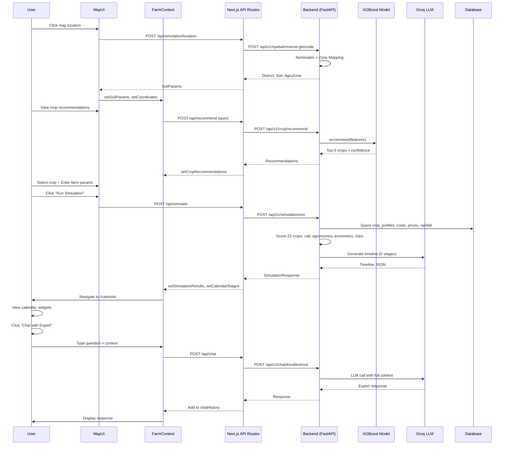

# End-to-End Workflows - AgriBrain

## Workflow 1: Farm Simulation (Complete User Journey)

### A. USER ACTION
- **Page**: `/simulate` (3-step wizard)
- **Step 1**: Click on India map to select farm location
- **Step 2**: Choose crop from ML recommendations
- **Step 3**: Enter farm parameters (area, budget, soil, season, date) → Click "Run Simulation"

### B. FRONTEND EXECUTION
| Step | Component | Handler | API Call |
|------|-----------|---------|----------|
| 1 | MapUI | `handleMapClick` → `lookupLocation` | POST `/api/simulation/location` |
| 2 | CropCard grid | `onClick` → `setSelectedCrop` | POST `/api/recommend` (on mount) |
| 3 | SimulationPanel | `handleRunSimulation` | POST `/api/simulate` |

**Payload (Step 3)**:
```json
{
  "district_id": 1,
  "crop_name": "Rice",
  "land_area_ha": 2.0,
  "budget_inr": 100000,
  "soil_type": "Alluvial Soil",
  "rainfall_mm": 800,
  "planting_season": "Kharif",
  "planting_date": "2024-06-15"
}
```
### C. BACKEND EXECUTION
**Endpoint**: `POST /api/v1/simulation/run` → `simulation.py:run_simulation`

**Processing Chain**:
1. `spatial.lookup_spatial()` → District, soil, agro-zone
2. `get_weather()` → Historical rainfall, temp, humidity
3. `score_crops()` → Score all 22 crops for suitability
4. `calculate_agronomics()` → NPK, water balance, yield
5. `calculate_economics()` → Costs (CropCost), revenue (CropPrice/MSP), ROI
6. `assess_risks()` → Drought, pest, soil stress
7. `generate_timeline()` → 5-stage cultivation (Groq LLM)
8. Build `SimulationResponse`

### D. DATABASE & DATA PROCESSING
| Table | Operation | Purpose |
|-------|-----------|---------|
| districts | SELECT | Location details |
| crop_profiles | SELECT | 22 crop parameters |
| crop_costs | SELECT | Per-activity costs |
| crop_prices | SELECT | Market prices |
| rainfall_monthly | SELECT | Historical rainfall |

**Transformations**:
- Coordinates → District (Nominatim + fallback)
- Raw weather → Crop suitability scores
- Agronomic params → NPK kg/ha, irrigation mm
- Costs + prices → Revenue, profit, ROI %
- Risk factors → risk_level enum

### E. RESPONSE & OUTPUT
**Backend Response** → Transformed in `/api/simulate/route.ts` → `FarmContext.simulationResults`

**Frontend State Updates**:
- `simulationResults`: Full simulation output
- `calendarStages`: Generated from monthly_breakdown
- `currentStep`: 4 (navigate to `/calendar`)

**User Sees**: SimulationResults component with yield, revenue, ROI, risk, digital twin metrics

### F. EXCEPTIONAL SCENARIOS
| Scenario | Handling |
|----------|----------|
| Nominatim timeout | Fallback deterministic zone mapping |
| No crop costs in DB | Default cost estimates |
| No market prices | Use MSP from crop profile |
| Groq LLM fails | Hardcoded 5-stage timeline fallback |
| Invalid coordinates | Error toast, stay on step 1 |

### G. VERIFICATION
- **Code Review**: Complete pipeline implemented
- **Build**: ✅ Passes
- **E2E Test**: ❌ Not automated
- **Manual Test**: ⚠️ Not verified end-to-end

---

## Workflow 2: Crop Recommendation

### A. USER ACTION
- **Page**: `/simulate` (Step 2)
- **Trigger**: Auto-on-mount after location selected
- **Input**: Soil params (N,P,K,pH) + weather (temp, humidity, rainfall)

### B. FRONTEND EXECUTION
```typescript
// simulate/page.tsx useEffect
useEffect(() => {
  if (coordinates && soilParams) {
    getCropRecommendations(coords[0], coords[1], soilParams)
      .then(setCropRecommendations)
  }
}, [coordinates, soilParams])
```

**API**: POST `/api/recommend` → backend `/api/v1/crop/recommend`

### C. BACKEND EXECUTION
**Endpoint**: `POST /api/v1/crop/recommend` → `crop_recommendation.py:recommend_crops`

**Processing**:
1. Validate 7 input features
2. Call `ml.inference.crop_recommendation.recommend()`
3. XGBoost `predict_proba()` → 22 class probabilities
4. Top-5 with confidence scores
5. Map indices to crop names via label_encoder

### D. DATABASE & DATA PROCESSING
- **Model**: `xgboost_crop_model.joblib` (loaded from disk)
- **Label Mapping**: `xgboost_crop_model_info.json`
- **No database queries** (pure ML inference)

### E. RESPONSE & OUTPUT
```json
{
  "recommendations": [
    {"crop_name": "Rice", "confidence": 0.87, "match_reasons": []},
    {"crop_name": "Maize", "confidence": 0.72, "match_reasons": []},
    ...
  ]
}
```
**Frontend**: Renders CropCard grid with confidence bars

### F. EXCEPTIONAL SCENARIOS
| Scenario | Handling |
|----------|----------|
| Model file missing | Fallback to RandomForest (legacy) |
| Invalid features | 400 error with validation details |
| Low confidence | Still returns top-5 (may include unknowns) |

### G. VERIFICATION
- **Unit Tests**: ✅ 3/3 passing (`test_crop_recommendation.py`)
- **Build**: ✅ Passes
- **Manual Test**: ⚠️ Not verified

---

## Workflow 3: Expert AI Chat (Text)

### A. USER ACTION
- **Page**: `/expert-chat` (Step 5)
- **Input**: Type question in chat input → Press Enter/Send
- **Context**: Full farm context auto-injected

### B. FRONTEND EXECUTION
**Component**: `ChatAssistant.tsx`
```typescript
const handleSend = async () => {
  const response = await sendChatMessage({
    message: userInput,
    session_id,
    context: { selectedCrop, farmParams, simulationResults, ... },
    is_context_aware: true
  })
}
```
**API**: POST `/api/chat` → backend `/api/v1/chat/troubleshoot`

### C. BACKEND EXECUTION
**Endpoint**: `POST /api/v1/chat/troubleshoot` → `chat.py:troubleshoot`

**Processing**:
1. Build system prompt with full farm context
2. Call Groq `llama-3.3-70b-versatile`
3. Retry with exponential backoff (3 attempts)
4. Return response text

**Context Injected**:
- Selected crop + variety
- Farm parameters (area, budget, soil, dates)
- Simulation results (yield, revenue, risks)
- Calendar stages (current stage, upcoming tasks)
- Coordinates + soil parameters
### D. DATABASE & DATA PROCESSING
- **No database** (stateless LLM call)
- **Session**: `session_id` for conversation continuity (not persisted)

### E. RESPONSE & OUTPUT
```json
{ "response": "Based on your Rice simulation in Punjab...\n\n**Nitrogen Application**:\n1. Basal: 50% at transplanting\n2. Tillering: 25% at 21 DAT\n3. Panicle: 25% at 45 DAT" }
```
**Frontend**: Renders with react-markdown, auto-scrolls, adds to chatHistory

### F. EXCEPTIONAL SCENARIOS
| Scenario | Handling |
|----------|----------|
| Groq rate limit | Exponential backoff retry (3x) |
| Groq API error | User-friendly error message |
| Context too large | Truncated (no explicit handling) |
| Empty response | Retry or show error |

### G. VERIFICATION
- **Code Review**: Complete with context injection
- **Build**: ✅ Passes
- **Manual Test**: ⚠️ Not verified end-to-end

---

## Workflow 4: Expert AI Chat (Vision)

### A. USER ACTION
- **Page**: `/expert-chat`
- **Input**: Click image icon → Select image file → Optional text → Send

### B. FRONTEND EXECUTION
```typescript
// ChatAssistant.tsx
const handleImageUpload = (file) => {
  const reader = new FileReader()
  reader.onload = () => setImagePreview(reader.result)
  reader.readAsDataURL(file)
}

const handleSend = async () => {
  const formData = new FormData()
  formData.append('message', userInput)
  formData.append('session_id', sessionId)
  formData.append('context', JSON.stringify(context))
  formData.append('image', imageFile)
  await sendChatMessage(formData) // FormData to /api/chat
}
```

### C. BACKEND EXECUTION
**Endpoint**: `POST /api/v1/chat/troubleshoot-vision` → `chat.py:troubleshoot_vision`

**Processing**:
1. Parse FormData (session_id, user_question, image, context)
2. Convert image to base64
3. Call Groq `llama-3.2-11b-vision-preview` with image + prompt
4. Return response

### D. DATABASE & DATA PROCESSING
- **No database**
- **Image**: Processed in-memory, not stored

### E. RESPONSE & OUTPUT
Same as text chat, but response references image content

---

## Workflow 5: Calendar Generation

### A. USER ACTION
- **Page**: `/calendar` (auto-navigated from simulation)
- **Trigger**: `useEffect` on `simulationResults` change

### B. FRONTEND EXECUTION
```typescript
// calendar/page.tsx
useEffect(() => {
  if (simulationResults && simulationResults.monthly_breakdown) {
    const stages = simulationResults.monthly_breakdown.map((month, i) => ({
      month: month.month,
      stage: growthStages[i], // Germination → Harvest
      tasks: stageTasks[growthStages[i]],
      dates: calculateDates(farmParams.planned_start_date, i)
    }))
    setStages(stages)
    setCalendarStages(stages) // FarmContext
  }
}, [simulationResults, farmParams])
```

### C. BACKEND EXECUTION
- **No backend call** (pure frontend transformation)
- Source data: `simulationResults.monthly_breakdown` from simulation API

### D. DATABASE & DATA PROCESSING
- **No database**
- **Transformation**: 6 months × 6 growth stages → CalendarStage[]

### E. RESPONSE & OUTPUT
**UI**: Accordion cards per month with:
- Stage name + month badge
- Description
- Rainfall / Irrigation / Date metrics
- Task checklist (stage-specific)

### F. EXCEPTIONAL SCENARIOS
| Scenario | Handling |
|----------|----------|
| No simulation results | Redirect to `/simulate` |
| Missing monthly_breakdown | Generate from planting date only |
| No farmParams | Use default dates |

### G. VERIFICATION
- **Code Review**: Complete
- **Build**: ✅ Passes
- **Manual Test**: ❌ Not verified

---

## Mermaid Sequence Diagram: Complete Simulation Journey



---

## Workflow Verification Summary

| Workflow | Frontend | Backend | ML | Database | LLM | E2E Tested |
|----------|----------|---------|-----|----------|-----|------------|
| Farm Simulation | ✅ | ✅ | ✅ | ⚠️ Schema only | ✅ | ❌ |
| Crop Recommendation | ✅ | ✅ | ✅ | N/A | N/A | ⚠️ Unit only |
| Expert Chat (Text) | ✅ | ✅ | N/A | N/A | ✅ | ❌ |
| Expert Chat (Vision) | ✅ | ✅ | N/A | N/A | ✅ | ❌ |
| Calendar Generation | ✅ | N/A | N/A | N/A | N/A | ❌ |

**Legend**: ✅ Implemented, ⚠️ Partial/Schema only, ❌ Not implemented/tested

---

## Mermaid Sequence Diagram: Complete Simulation Journey


---

## Workflow Verification Summary

| Workflow | Frontend | Backend | ML | Database | LLM | E2E Tested |
|----------|----------|---------|-----|----------|-----|------------|
| Farm Simulation | ✅ | ✅ | ✅ | ⚠️ Schema only | ✅ | ❌ |
| Crop Recommendation | ✅ | ✅ | ✅ | N/A | N/A | ⚠️ Unit only |
| Expert Chat (Text) | ✅ | ✅ | N/A | N/A | ✅ | ❌ |
| Expert Chat (Vision) | ✅ | ✅ | N/A | N/A | ✅ | ❌ |
| Calendar Generation | ✅ | N/A | N/A | N/A | N/A | ❌ |

**Legend**: ✅ Implemented, ⚠️ Partial/Schema only, ❌ Not implemented/tested
Same as text chat, but response references image content

### F. EXCEPTIONAL SCENARIOS
| Scenario | Handling |
|----------|----------|
| Image too large | No validation (Groq handles) |
| Invalid format | Groq error → user message |
| No text with image | Still processes (image-only query) |

### G. VERIFICATION
- **Code Review**: Implemented
- **Build**: ✅ Passes
- **Manual Test**: ❌ Not verified
- Annual rainfall